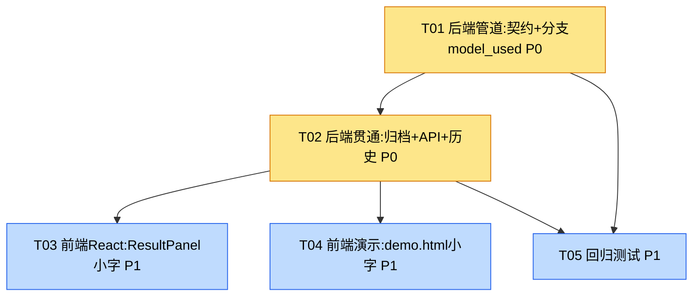

# AI 盲盒 · 成品所用模型弱化提示 — 系统架构设计 + 任务分解

> 架构师：高见远（software-architect）
> 需求来源：去掉「creative/planner 不显示」后，每次开盒把「产出本次成品所使用的模型」作为弱化小字随结果返回并在前端成品旁展示。
> 主理人已拍板 3 个决策：① Mock 模式统一显示「Mock 模拟」；② 全模式前端统一「由 {model_used} 生成」，不再单独展示 tts_info 行（后端保留 tts_info 字段）；③ image 分支漏写 `return _call_with_fallback(...)`，本轮 P0 仅补这一行调用（同时修复真实调用缺口并捕获所用模型）。

---

## Part A：系统设计

### 1. 实现方案（Implementation Approach）

**技术难点**
1. `_call_with_fallback` 当前只回传内容、不回传「成功用的是哪个模型」。要捕获 model_used，必须改动其返回契约，且不能破坏 creative/planner 等中间环节调用方。
2. image 分支已定义完整 `call` 但漏写调用，导致 image 实际走 `return plan`（返回规划文本而非图片）——这是真实调用缺口，补行即可一石二鸟。
3. tts 的模型名原先由 `_cloud_one` 返回 `(dest, model)`，需与新的 `_call_with_fallback` 契约协同，避免重复/错位。
4. mock 策略需在所有 executor 分支、tts 子分支统一落地「Mock 模拟」，且非 mock 时按真实模型名（云端）/「Edge TTS」（Edge 回退）展示。

**框架选型（沿用现有，无新框架）**
- 后端：FastAPI（已有 `backend/app/main.py`）+ 纯 Python 管道（`pipeline.py`），不引入新依赖。
- 前端生产版：React + Vite（`frontend/src/components/ResultPanel.jsx` 等），样式复用已有 `frontend/src/styles.css`。
- 前端演示版：preact + htm（免构建，`frontend/demo.html` 自带 `<style>`）。
- 架构模式：现有「管道编排」模式（creative → planner → executor → archive），本次仅做字段贯通，不新增分层。

### 2. 文件列表（相对/绝对路径）

| 改动 | 路径 |
|------|------|
| 改 | `D:\work\AI_Blindbox\backend\app\pipeline.py` |
| 改 | `D:\work\AI_Blindbox\backend\app\main.py` |
| 改 | `D:\work\AI_Blindbox\frontend\src\components\ResultPanel.jsx` |
| 改 | `D:\work\AI_Blindbox\frontend\demo.html` |
| 新增（测试） | `D:\work\AI_Blindbox\backend\tests\test_model_used.py` |

**关联上下文（不改，仅供理解）**：`backend/app/config.py`（settings 提供 `mock` 开关与 `output_dir`）、`frontend/src/App.jsx`（把 `/api/open` 的 result 透传给 ResultPanel）、`frontend/src/styles.css`（全局样式，可选放 `.model-hint`）。

### 3. 数据结构与接口（Data Structures & Interfaces）

#### 3.1 `BlindBoxResult` 数据类（新增字段）

```python
@dataclass
class BlindBoxResult:
    seed: str
    concept: str
    plan: str
    output: str
    output_kind: str
    archived: dict | None = None
    tts_info: str | None = None          # 保留（后端无害，前端不再单独展示）
    caption: str | None = None
    model_used: str | None = None        # ★ 新增：产出本次成品所用模型；None = 不展示
```

#### 3.2 `_call_with_fallback` 返回契约变更

| 项 | 旧 | 新 |
|----|----|----|
| 返回 | `call_fn(creds)`（单值） | `call_fn(creds), creds["model"]`（二元组 `(result, used_model)`） |
| 影响面 | — | 所有调用方需解包；`_agent_call` 内部解包后仅返回 `result`（保持 str 契约） |

```python
def _call_with_fallback(models: list[dict], call_fn, ctx: str = "") -> "tuple[Any, str]":
    last: Exception | None = None
    for creds in models:
        try:
            return call_fn(creds), creds["model"]
        except Exception as e:
            last = e
    raise FallbackExhausted(ctx, last)
```

#### 3.3 `_cloud_one` 新签名（仅返回 dest）

| 项 | 旧 | 新 |
|----|----|----|
| 返回 | `tuple[Path, str]`（`(dest, model)`） | `Path`（仅 `dest`） |
| 模型名来源 | 内部 `model = creds["model"]` 再回传 | 由外层 `_call_with_fallback` 的 `creds["model"]` 捕获 |

```python
def _cloud_one(creds: dict) -> Path:
    # ... 内部逻辑不变，仅最后 `return dest`（去掉 `, model`）
```

#### 3.4 `_run_tts` 新签名（透传 result，内部设 model_used）

```python
def _run_tts(plan: str, mode: dict[str, Any], result: "BlindBoxResult | None" = None) -> tuple[str, str]:
    # 各分支在 return 前：if result is not None: result.model_used = <对应值>
    #   mock 短路 -> "Mock 模拟"
    #   无凭据 Edge -> "Edge TTS"
    #   云端成功   -> creds["model"]（如 "gpt-4o-mini-tts"）
    #   云端失败回退 Edge -> "Edge TTS"
```

#### 3.5 API 端点响应新增字段

`POST /api/open` 返回体新增 `model_used`；`GET /api/history` 每条 item 新增 `model_used`。

| 端点 | 字段 | 取值 |
|------|------|------|
| `/api/open` | `model_used` | `result.model_used`（str 或 null） |
| `/api/history` | `model_used`（item 级） | `rec.get("model_used", "")` |
| 归档 `result_*.json` | `model_used` | `result.model_used`（落盘持久化） |

#### 3.6 JSON Schema 速览（open_box 响应增量）

```json
{
  "seed": "string",
  "concept": "string",
  "plan": "string",
  "output": "string",
  "output_kind": "text|image_url|video_file|audio_file|spec_md|game_html",
  "tts_info": "string|null",
  "caption": "string|null",
  "archived": "object|null",
  "model_used": "string|null   // ★ 新增"
}
```

### 4. 程序调用流程（Program Call Flow）

开盒 → executor 各分支经 `_call_with_fallback` 拿到 `(out, used)` 写入 `result.model_used` → archive 落盘 → `/api/open` 返回 → 前端展示小字。详见 `docs/sequence-diagram.mermaid`。

要点：
- **text/image/video/game**：在各自分支 `out, used = _call_with_fallback(...)` 后 `result.model_used = used`。
- **tts**：`result` 透传进 `_run_tts`，在 mock / Edge / 云端成功 / 云端回退各分支内直接 `result.model_used = ...`。
- **code-spec / code-cli**：无模型调用，`model_used` 保持 `None`（前端不渲染）。
- **image 修复**：在已定义的 `call` 之后补 `return _call_with_fallback(models, call, ctx="executor:image")`，同时 `result.model_used = used`。

### 5. 待明确事项（Anything UNCLEAR）

1. **game 的 `FallbackExhausted` 分支**（所有模型失败回退占位小游戏）：本设计保持 `model_used = None`（不展示），因为成品并非任何模型产出。若希望显示「占位小游戏」字样，可在此分支补 `result.model_used = "占位小游戏"`——需主理人确认口径。
2. **React 生产版历史面板 `frontend/src/components/HistoryPanel.jsx`**：本次范围仅含 `ResultPanel.jsx` 与 `demo.html`（演示版历史）。若生产版历史也需展示 model_used，建议作为 T3 的小幅延伸（一致体验），当前未列入任务，请主理人确认是否纳入。
3. **非 mock 云端 TTS 的 model_used 展示值**：取 `creds["model"]` 原值（如 `gpt-4o-mini-tts`），不再加工；Edge 回退统一为「Edge TTS」。是否符合「弱化提示」预期？
4. `caption` / `tts_info` 字段保留不动，`tts_info` 后端继续落盘但前端不再渲染。

---

## Part B：任务分解

> 说明：本特性只触及 4 个核心文件 + 1 个新测试文件，远小于通用模板的「每任务 ≥3 文件」量级；故按**分层（后端管道 / 后端 API / 前端 React / 前端演示 / 测试）**收口为 **5 个任务**（满足「≤5 任务」硬上限），并显式偏离「每任务≥3文件」规则（已在上方说明）。任务依赖与团队主理人建议的 T1–T6 一一对应、顺序一致。

### 6. 依赖包列表（Required Packages）

无需新增第三方依赖。后端继续用 `fastapi` / `openai` / `edge-tts`（已存在）；前端继续用 React / preact+htm（已存在）。

```
# 无新增依赖
```

### 7. 任务列表（有序、含依赖、按实现顺序）

#### T01 — 后端管道：核心契约 + 各 executor 分支填充 model_used  ⭐P0
- **源文件**：`backend/app/pipeline.py`
- **依赖**：无（首个任务）
- **具体改动点**：
  1. `BlindBoxResult`（约 73–82 行）：新增字段 `model_used: str | None = None`。
  2. `_call_with_fallback`（58–70 行）：`return call_fn(creds)` → `return call_fn(creds), creds["model"]`；返回类型注解改为 `"tuple[Any, str]"`。
  3. `_agent_call`（231–259 行）：第 259 行 `return _call_with_fallback(...)` 改为 `out, _used = _call_with_fallback(...); return out`（保持对 creative/planner 返回 str 的契约，避免 `run_blind_box` 中 `concept = _agent_call(...)` 拿到元组）。
  4. `_run_executor` 各分支：
     - **text**（423–481）：mock 分支（430–438）返回前 `result.model_used = "Mock 模拟"`；末尾 `return _call_with_fallback(models, call, ctx="executor:text")` →
       ```python
       out, used = _call_with_fallback(models, call, ctx="executor:text")
       result.model_used = used
       return out
       ```
     - **image**（483–535）：mock 分支（489–491）返回前 `result.model_used = "Mock 模拟"`；在 `def call(...)`（止于 533 行）之后补：
       ```python
       out, used = _call_with_fallback(models, call, ctx="executor:image")
       result.model_used = used
       return out
       ```
       （修复漏写调用 → 真实图片缺口 + 捕获模型名，一举两得）
     - **tts**（536–540）：改为 `path, info = _run_tts(plan, mode, result)`（透传 result），保留 `result.tts_info = info`。
     - **video**（542–610）：mock 分支（548–550）返回前 `result.model_used = "Mock 模拟"`；末尾 `return _call_with_fallback(models, call, ctx="executor:video")` → `out, used = ...; result.model_used = used; return out`。
     - **code-spec / code-cli**（612–621）：不改（model_used 保持 None）。
     - **game**（623–624）：`return _run_game_executor(plan, mode, result)`（已含 result）。
  5. `_run_game_executor`（720–802）：mock 分支（744–746）返回前 `result.model_used = "Mock 模拟"`；第 800 行 `return _call_with_fallback(models, call, ctx="executor:game")` → `out, used = ...; result.model_used = used; return out`；`except FallbackExhausted`（801–802）保持 `model_used = None`（见待明确①）。
  6. `_run_tts`（805 起）：签名改为 `_run_tts(plan, mode, result=None)`；内部各 return 前按分支设 `result.model_used`（mock→"Mock 模拟"；无凭据 Edge→"Edge TTS"；云端空回退 Edge→"Edge TTS"；云端成功→`used`；云端失败回退 Edge→"Edge TTS"）。其中云端成功段（965–966）：
     ```python
     dest, used = _call_with_fallback(models, _cloud_one, ctx="tts")
     info = f"{used}（云端大模型）"
     if result is not None:
         result.model_used = used
     return (str(dest), info)
     ```
  7. `_cloud_one`（887–941）：返回值由 `tuple[Path, str]` 改为 `Path`，最后 `return dest`（去掉 `, model`）；其余逻辑不变。

#### T02 — 后端贯通：归档 + API 响应 + 历史回显  ⭐P0
- **源文件**：`backend/app/pipeline.py`（仅 `archive_result`）、`backend/app/main.py`
- **依赖**：T01（model_used 字段已存在且被填充）
- **具体改动点**：
  1. `archive_result` 的 `record` 字典（1063–1074）：新增 `"model_used": result.model_used`（落盘持久化）。
  2. `main.py` `open_box`（261–276）：返回 dict（265–274）新增 `"model_used": result.model_used`。
  3. `main.py` `list_history`（90–135）：items 构造（112–125）新增 `"model_used": rec.get("model_used", "")`。

#### T03 — 前端 React：ResultPanel 模型小字  ⭐P1
- **源文件**：`frontend/src/components/ResultPanel.jsx`
- **依赖**：T02（API 契约已稳定；可与 T04 并行）
- **具体改动点**：
  1. 第 4 行解构：`const { seed, concept, plan, output, output_kind, archived, tts_info } = result;` → 增加 `model_used`。
  2. **audio 分支**（76–80 行）：删除 `🎙 合成：{tts_info}` 这一独立行（统一改用 model_used）。
  3. 在成品渲染块之后（第 107 行 `)}` 之后、第 109 行 `{archived && ...}` 之前）统一插入一处小字：
     ```jsx
     {model_used && (
       <div className="model-hint">由 {model_used} 生成</div>
     )}
     ```
     （覆盖 text/image/video/game；code-spec/code-cli 与 game 回退为 None 时不渲染）
  4. 样式：为 `.model-hint` 用内联样式（小字、灰色弱化，约 12px）：
     `style={{ fontSize: 12, color: "#9aa0aa", marginTop: 6, opacity: 0.85 }}`
     （如项目统一走 `styles.css`，也可在 `frontend/src/styles.css` 加 `.model-hint{font-size:12px;color:var(--muted);margin-top:6px;opacity:.85}`，二选一）。

#### T04 — 前端演示页：demo.html 主结果 + 历史小字  ⭐P1
- **源文件**：`frontend/demo.html`
- **依赖**：T02（API 契约已稳定；可与 T03 并行）
- **具体改动点**：
  1. `<style>`（7–73 行）新增类：`.model-hint{font-size:12px;color:var(--muted);margin-top:6px;opacity:.85}`。
  2. **主结果区**：audio 分支（465 行）删除 `🎙 合成：${result.tts_info}` 独立行；在成品块之后（第 470 行 `🎮 小游戏` 注释块之后、第 471 行 `{result.archived && ...}` 之前）插入：
     ```js
     ${result.model_used ? html`<div class="model-hint">由 ${result.model_used} 生成</div>` : null}
     ```
  3. **历史区**：audio 分支（605 行）删除 `🎙 合成：${it.tts_info}` 独立行；在展开成品块之后（第 605 行 `}` 之后、第 606 行 `<div class="archive-links">` 之前）插入：
     ```js
     ${it.model_used ? html`<div class="model-hint">由 ${it.model_used} 生成</div>` : null}
     ```
     （覆盖历史中各 output_kind；model_used 为空则不渲染）

#### T05 — 回归测试：model_used 全链路验证  ⭐P1
- **源文件**：`backend/tests/test_model_used.py`（新建）
- **依赖**：T01、T02
- **具体改动点**（测试用例，不修改业务代码）：
  1. `mock=True` 下对 text/image/video/game/tts 各 executor 断言 `result.model_used == "Mock 模拟"`。
  2. 非 mock（构造假凭据 + monkeypatch `OpenAI`）断言 `result.model_used` 为传入的 `creds["model"]` 或合理值（云端 tts→模型名、Edge→"Edge TTS"）。
  3. `code-spec` / `code-cli` 断言 `result.model_used is None`。
  4. `archive_result` 后 `record["model_used"] == result.model_used`。
  5. （可选）用 `fastapi.testclient` 调用 `/api/open` 与 `/api/history` 断言响应/条目含 `model_used`。
- 运行：`backend/.venv/Scripts/python -m pytest backend/tests/test_model_used.py -q`

### 8. 共享知识（Shared Knowledge / 跨文件约定）

- **文案统一**：前端一律渲染「由 {model_used} 生成」；不在音频分支单独展示 `tts_info`。
- **Mock 统一**：凡 mock 模式或 mock 分支命中，`model_used = "Mock 模拟"`（不暴露配置模型名，避免误导）。
- **不渲染规则**：`model_used` 为 `None` / 空串时，前端（ResultPanel / demo.html）一律不渲染小字行。
- **字段贯通**：`BlindBoxResult.model_used` → `archive_result.record["model_used"]` → `/api/open` 响应 → 前端；历史读取 `rec.get("model_used", "")` → 前端；四端字段名与含义必须一致。
- **返回契约**：`_call_with_fallback` 现在返回 `(result, used_model)`；任何新增调用方都需解包，中间环节（`_agent_call`）只需 `result`。
- **tts 后端保留**：`tts_info` 字段继续落盘/返回（无害），仅前端不再单独展示。

### 9. 任务依赖图（Task Dependency Graph）


